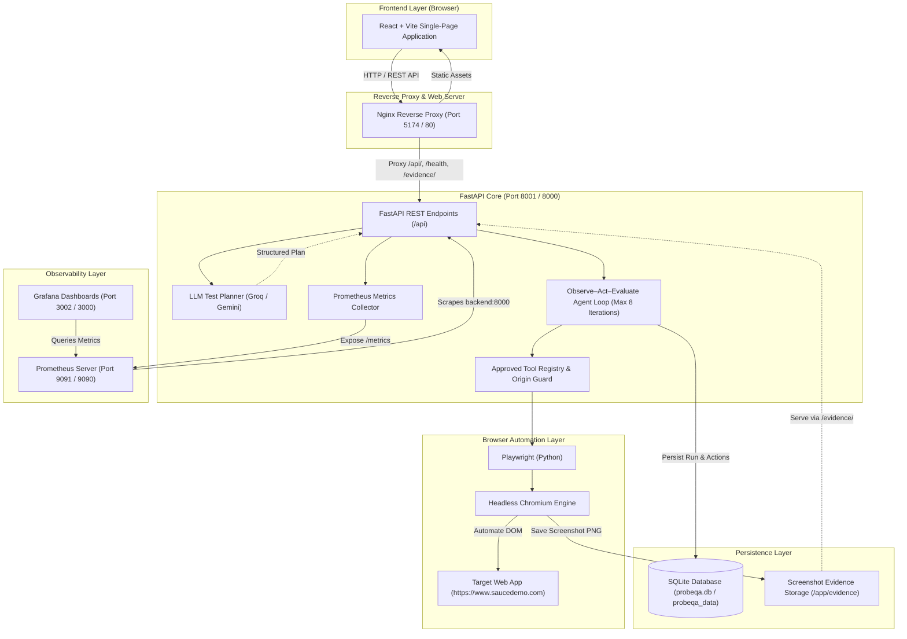

# ProbeQA — AI-Assisted Web Testing Agent

ProbeQA is an AI-assisted web quality assurance agent that plans and executes controlled, reliable browser tests using Large Language Models (LLMs), Playwright automation, and deterministic DOM assertions.

Testing web applications often involves repetitive manual verification, fragile automated test scripts, incomplete failure diagnostics, and fragmented test history. ProbeQA addresses these challenges through a **bounded Observe–Act–Evaluate agent loop** with human-in-the-loop approval, strict element-allowlist safeguards, automated failure screenshot capture, SQLite test history persistence, Prometheus/Grafana observability, and a multi-container Docker Compose deployment.

---

## 1. Key Features

- **Interactive React Dashboard**: Modern React + Vite user interface for reviewing AI-suggested test plans, inspecting live step-by-step traces, viewing full-page failure screenshots, and analyzing historical test metrics.
- **FastAPI Asynchronous Backend**: High-performance Python backend exposing structured REST endpoints for planning, step-by-step execution, persistent run logs, and Prometheus metrics.
- **Dual LLM Provider Architecture**: Native support for **Groq** (via OpenAI-compatible API, default `qwen/qwen3.8-27b`) and **Google Gemini** (`gemini-2.5-flash`), with transparent provider labeling and an automated rule-based deterministic fallback when external APIs are unavailable.
- **Human-in-the-Loop Test Planning**: The model generates a structured, multi-step test plan that users can inspect, modify, and explicitly approve before browser execution begins.
- **Bounded Observe–Act–Evaluate Agent Loop**: Operates in an iterative feedback cycle: captures real-time page state, sends observations to the model, selects an approved action, validates with strict Pydantic schemas, and stops deterministically upon goal fulfillment (bounded by `MAX_AGENT_ITERATIONS = 8`).
- **Playwright Headless Automation**: Drives Chromium via Playwright, executing low-level interactions (navigation, keystrokes, form input, element clicks) and capturing full-page PNG screenshots.
- **Strict Element & Origin Safeguards**: Autonomous browser actions are restricted to registered element aliases and the approved target origin (`https://www.saucedemo.com`), mitigating risks of arbitrary web navigation.
- **Persistent SQLite Run History**: Real test runs are persisted in SQLite using SQLAlchemy (`backend/probeqa.db` locally or named volume `probeqa_data` in Docker), recording run IDs, target URLs, scenario names, provider models, execution duration, assertion verdicts, and screenshot file paths.
- **Comprehensive Prometheus & Grafana Observability**: Instrumented with `prometheus-client` tracking HTTP counters, request duration histograms, agent run durations, iteration distributions, and active gauges, paired with pre-provisioned Grafana dashboards.
- **Docker Compose Orchestration**: Multi-container stack (Backend, Frontend, Prometheus, Grafana) with health checks, persistent volumes for databases, host bind mounts for evidence, and secure environment-variable password configuration.
- **Deterministic GitHub Actions CI**: Automated CI pipeline running unit tests, telemetry checks, deterministic mock agent benchmarks, Vite compilation, and Docker builds without requiring private API keys.

> [!NOTE]
> **Scope Notice**: The current autonomous browser agent loop is bounded and specifically validated against the SauceDemo e-commerce workflow (`https://www.saucedemo.com`). It is designed for controlled, repeatable QA workflows and does not claim unbounded general web scraping or unconstrained site navigation.

---

## 2. System Architecture

The following diagram illustrates how user interactions flow through the application layers, storage engines, and observability stack:



---

## 3. Technology Stack

| Domain | Technologies & Libraries |
|---|---|
| **Frontend UI** | React 19, Vite, Tailwind CSS, Lucide React icons, native Fetch API |
| **Backend API** | Python 3.11+, FastAPI, Uvicorn, Pydantic v2, HTTPX, Python-Dotenv |
| **AI & LLM Providers** | Groq API (`qwen/qwen3.8-27b`), Google Gemini API (`gemini-2.5-flash`), Rule-based fallback |
| **Browser Automation** | Playwright for Python, Headless Chromium, DOM element locators |
| **Data Persistence** | SQLite 3, SQLAlchemy ORM, JSON-encoded action traces |
| **Observability** | Prometheus (`prometheus-client`), Grafana 11.5.2 |
| **Containerization** | Docker, Docker Compose, Multi-stage Dockerfiles, Nginx Alpine |
| **Continuous Integration**| GitHub Actions (`ubuntu-latest`, Python 3.11, Node.js 20, Docker Buildx) |

---

## 4. UI Preview & Screenshots

The ProbeQA dashboard provides real-time visibility into test execution, AI decision traces, and captured screenshot artifacts:

<p align="center">
  
</p>

*Above: The ProbeQA interface displaying active test scenarios, execution health metrics, and run history. Full failure screenshots and action traces are displayed directly in the dashboard after each run.*

> [!TIP]
> To experience the complete interactive dashboard, clone the repository and launch the application locally or via Docker Compose using the instructions below.

---

## 5. Quickstart: Reproducing a Supported SauceDemo Test

Recruiters and reviewers can execute and verify a real browser QA run in under two minutes:

### Option A: Using the Web Dashboard
1. Open the frontend dashboard at `http://localhost:5173` (local dev) or `http://127.0.0.1:5174` (Docker).
2. Navigate to **New Test Plan** or **Scenarios**.
3. Select the predefined workflow: **Standard User Login & Inventory Check**.
4. Click **Run Test**. Playwright will launch Chromium, perform the login steps, verify that 6 products are displayed, and capture full-page screenshot evidence.
5. Review the execution status (`passed`), duration (~2.5–4.5s), and the captured screenshot directly in the dashboard.

### Option B: Using cURL / REST API
Execute a direct smoke test against the containerized backend:

```bash
curl -X POST http://127.0.0.1:8001/api/tests/run \
  -H "Content-Type: application/json" \
  -d '{"url": "https://www.saucedemo.com", "scenario": "saucedemo_login"}'
```

**Expected JSON Response:**
```json
{
  "run_id": "2893efca567f",
  "status": "passed",
  "scenario": "saucedemo_login",
  "screenshot_path": "evidence/run_2893efca567f.png"
}
```

The resulting full-page PNG screenshot is immediately viewable in your browser at `http://127.0.0.1:8001/evidence/run_2893efca567f.png` and persisted on disk at `backend/evidence/run_2893efca567f.png`.

---

## 6. Local Development Setup

### Prerequisites
- **Python**: Version 3.11 or newer
- **Node.js**: Version 20.x or newer (with npm)
- **Git**

### Step 1: Clone the Repository
```bash
git clone https://github.com/HarshShahdeo1/ProbeQA.git
cd ProbeQA
```

### Step 2: Configure Environment Variables
Copy the template files into real local environment files:

```bash
# Frontend environment
cp .env.example .env.local

# Backend environment
cp backend/.env.example backend/.env
```

Edit `backend/.env` with your API keys (optional if running in rule-based or mock mode):
```ini
LLM_PROVIDER=groq
GROQ_API_KEY=your_actual_groq_api_key_here
GROQ_MODEL=qwen/qwen3.8-27b

# Or configure Gemini:
GEMINI_API_KEY=your_gemini_api_key_here
GEMINI_MODEL=gemini-2.5-flash

# SQLite storage path (defaults to backend/probeqa.db if unset):
DATABASE_URL=sqlite:///backend/probeqa.db
```

### Step 3: Set Up and Run the Python Backend
Open a terminal in the project root:

```bash
# 1. Create a Python virtual environment
python -m venv venv

# 2. Activate the virtual environment
# On Windows (PowerShell):
.\venv\Scripts\Activate.ps1
# On macOS / Linux:
source venv/bin/activate

# 3. Install backend dependencies
pip install -r backend/requirements.txt

# 4. Install Playwright browser binaries and dependencies
playwright install chromium

# 5. Start the FastAPI development server
uvicorn main:app --app-dir backend --host 127.0.0.1 --port 8000 --reload
```

The backend API will be available at `http://127.0.0.1:8000`, with interactive Swagger documentation at `http://127.0.0.1:8000/docs`.

### Step 4: Set Up and Run the React Frontend
Open a second terminal in the project root:

```bash
# 1. Install Node.js dependencies
npm install

# 2. Start the Vite development server
npm run dev
```

Open `http://localhost:5173` in your browser to access the ProbeQA UI.

---

## 7. Docker Compose Deployment

ProbeQA provides a production-grade multi-container stack orchestrated via Docker Compose.

### Step 1: Configure Root Environment for Docker Compose
Before starting Docker Compose, copy `.env.example` to `.env` in the project root and specify a secure Grafana password:

```bash
cp .env.example .env
```

Edit `.env`:
```ini
GF_SECURITY_ADMIN_USER=admin
GF_SECURITY_ADMIN_PASSWORD=your_secure_password_here
```

> [!IMPORTANT]
> `docker-compose.yml` strictly requires `GF_SECURITY_ADMIN_PASSWORD`. It will refuse to start with insecure defaults if this variable is missing from your local `.env`.

### Step 2: Start the Container Stack
```bash
# Start all 4 containers in the background
docker compose up -d
```

### Verified Container Access Endpoints:

| Service | Container Name | Host Published URL | Description |
|---|---|---|---|
| **Frontend Web** | `probeqa-frontend` | `http://127.0.0.1:5174` | React SPA served via Nginx with dynamic reverse proxy |
| **Backend API** | `probeqa-backend` | `http://127.0.0.1:8001/docs` | FastAPI Swagger documentation & REST endpoints |
| **Prometheus** | `probeqa-prometheus` | `http://127.0.0.1:9091` | Prometheus web UI & target status (`/targets`) |
| **Grafana** | `probeqa-grafana` | `http://127.0.0.1:3002` | Metrics visualization dashboard (login: `admin` / your password) |

### Persistent Storage & Evidence Mounts:
- **SQLite Database Persistence**:
  - **Local Development**: Stored directly at `backend/probeqa.db`.
  - **Docker Containers**: Stored inside the container at `/app/data/probeqa.db` and backed by the named Docker volume `probeqa_data:/app/data`. Database records survive container destruction and restarts.
- **Screenshot Evidence Storage**:
  - Saved as PNG files in `backend/evidence/`.
  - In Docker, mapped via host bind mount `./backend/evidence:/app/evidence`. Screenshots captured by Playwright inside Linux Chromium are instantly accessible on your host machine.
  - SQLite records store only relative paths (`evidence/run_{run_id}.png`), keeping large binary image blobs out of the database.
- **Port Conflict Prevention**:
  Published ports (`5174`, `8001`, `9091`, `3002`) are chosen to prevent bind errors if you already have local dev servers running on ports `5173`, `8000`, `9090`, or `3000`.

To stop the containers without deleting database records or screenshot files:
```bash
docker compose down
```

---

## 8. REST API Reference

The FastAPI backend exposes the following structured endpoints:

| Method | Endpoint | Description |
|---|---|---|
| `GET` | `/health` | Health check endpoint returning backend status and timestamp. |
| `GET` | `/metrics` | Prometheus exposition endpoint for scraping system and agent metrics. |
| `POST` | `/api/agent/plan` | Accepts a natural language testing goal and returns a structured multi-step plan. |
| `POST` | `/api/agent/execute` | Executes an approved plan deterministically through Playwright. |
| `POST` | `/api/agent/loop/run` | Executes the autonomous Bounded Observe–Act–Evaluate agent loop. |
| `POST` | `/api/tests/run` | Direct execution route for predefined deterministic scenarios (e.g. `saucedemo_login`). |
| `GET` | `/api/runs` | Returns paginated test run history from the SQLite database. |
| `GET` | `/api/runs/{run_id}` | Retrieves full diagnostic details, assertions, and action traces for a specific run. |
| `GET` | `/api/reports/summary` | Aggregates pass rates, average durations, and scenario distributions. |
| `GET` | `/evidence/{filename}` | Serves captured full-page PNG screenshots. |

---

## 9. Testing & Continuous Integration

ProbeQA enforces reliability across four distinct testing layers:

### Running Tests Locally

```bash
# 1. Database CRUD & Schema Migration Tests (7/7 passed)
python backend/test_database.py

# 2. Prometheus Telemetry & Cardinality Tests (6/6 passed)
python backend/test_metrics.py

# 3. Deterministic Mock Agent Evaluation Benchmark (4/4 passed, 100% offline)
python backend/evaluation_suite.py --mode=mock

# 4. Frontend Production Build Check
npm run build

# 5. Docker Compose Syntax & Configuration Check
docker compose config
```

### Live Browser Evaluation Suite (Optional)
To benchmark the agent loop against real headless Chromium browser automation:
```bash
python backend/evaluation_suite.py --mode=live
```

### GitHub Actions CI Pipeline
The automated workflow in [`.github/workflows/ci.yml`](.github/workflows/ci.yml) triggers on every push and pull request to `main`:
1. **`test-backend`**: Sets up Python 3.11, installs dependencies, verifies SQLite persistence, validates telemetry exposition, and executes the deterministic agent benchmark in `--mode=mock` without external API dependencies.
2. **`test-frontend`**: Sets up Node.js 20, runs `npm ci`, and builds the Vite production bundle.
3. **`docker-build`**: Validates `docker compose config` and builds production Docker images for both backend and frontend.

---

## 10. Security & Current Limitations

### Security Safeguards
- **Origin Guard**: Navigation is restricted to approved testing domains (`https://www.saucedemo.com`). Attempts to navigate to unauthorized internal or external domains are rejected.
- **Approved Tool Registry**: The agent loop is constrained to an explicit set of actions (`navigate`, `fill`, `click`, `press_key`, `assert_url`, `assert_text_visible`, `assert_element_visible`, `stop`). Arbitrary JavaScript execution is prohibited.
- **Credential Quarantine**: Personal API keys, passwords, and `.env` files are excluded from Git and Docker build contexts via `.gitignore` and `.dockerignore`.
- **Human-in-the-Loop Approval**: Generated test plans must be explicitly accepted by the user before execution.
- **Deterministic DOM Assertions**: Pass/fail outcomes are evaluated strictly through actual Playwright DOM assertions (`page.url`, `page.text_content`, `page.locator`), never by LLM self-reporting.

### Current Limitations
- **Workflow Scope**: The autonomous agent loop is currently optimized and bounded for the SauceDemo e-commerce application. It does not generalize to arbitrary, unmapped multi-page web applications.
- **Max Iterations**: The agent loop enforces a strict bound of `MAX_AGENT_ITERATIONS = 8` to prevent infinite execution loops on unresponsive pages.
- **Single-Page Application State**: Highly dynamic canvas elements, WebSocket-heavy interfaces, and multi-tab workflows are not currently supported.

---

## 11. Roadmap

- [ ] **Multi-Domain Configuration**: Extensible domain registry enabling users to configure approved URL allowlists and custom element aliases via YAML.
- [ ] **Visual Regression Comparison**: Perceptual pixel-diffing against baseline screenshots to detect unexpected layout regressions.
- [ ] **Dynamic DOM Self-Healing**: Adaptive element selector recovery using semantic similarity when button or input IDs change.
- [ ] **Distributed Execution**: Worker queue integration (Celery / Redis) for parallel browser test execution.

---

## 12. License

This repository does not currently include an open-source license. All rights are reserved by the repository owner. Contact the author for permissions regarding usage or distribution.
